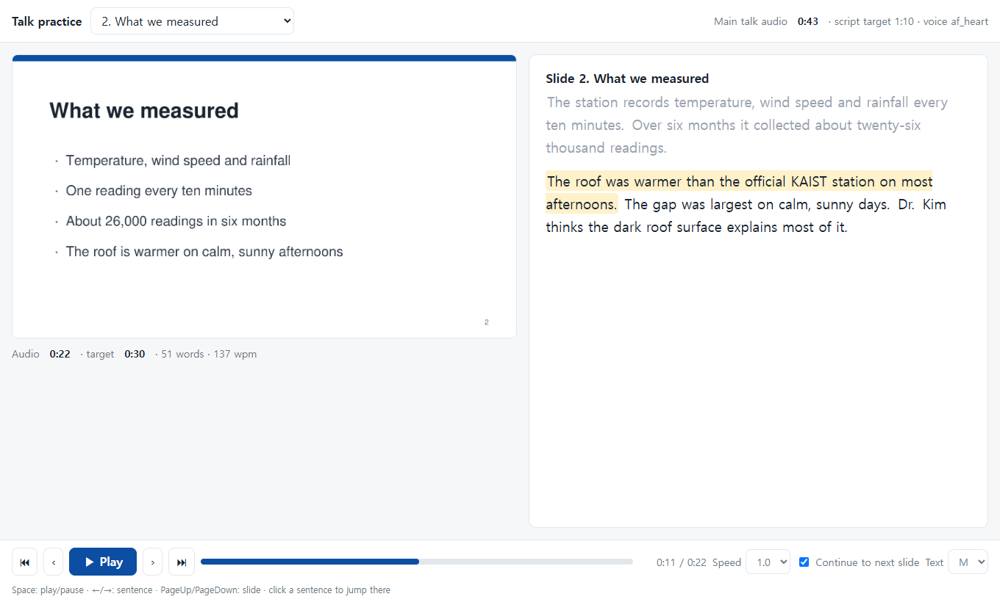

# talk-practice-kit

Practice an English talk on your own computer. You give the kit your script and your slides as a PDF. It builds a page with the slide on the left and the script on the right, reads the script aloud with a local text-to-speech model (Kokoro-82M), and highlights the sentence being read. The script and the slides are never sent online. The rest of this README is in Korean.



## Setup

Python 3.12 또는 3.13이 필요합니다. 패키지와 모델 파일(350 MB)을 내려받느라 10분쯤 걸립니다.

```
git clone https://github.com/jiheunha/talk-practice-kit.git
cd talk-practice-kit
py -3.13 setup_kit.py          # Windows
python3.13 setup_kit.py        # macOS
```

설치가 끝나면 예제를 빌드하고 `example/app/index.html`을 Chrome에서 엽니다.

```
.venv\Scripts\python build.py --script example/script.md --deck example/deck.pdf --out example/app
```

macOS에서는 `.venv/bin/python`을 씁니다.

Claude Code를 쓴다면 [PROMPT_for_lab.md](PROMPT_for_lab.md)의 프롬프트를 붙여 넣으세요. 설치부터 첫 빌드까지 도와줍니다.

## Build your talk

`talks/<name>/`에 `script.md`와 `deck.pdf`를 넣고 빌드합니다.

```
.venv\Scripts\python build.py --script talks/<name>/script.md --deck talks/<name>/deck.pdf --out talks/<name>/app
```

`talks/<name>/app/index.html`을 엽니다. 스크립트를 고친 뒤에는 같은 명령을 다시 실행하고 Ctrl+F5로 새로고침합니다. 바뀐 문장만 다시 합성합니다.

옵션: `--voice`(기본 `af_heart`), `--speed`(기본 `0.85`), `--no-images`(슬라이드 이미지를 다시 만들지 않음).

## Script format

```markdown
## Slide 1. A weather station on the roof (0:20)

*Smile and wait for the room to settle.*

Good afternoon, everyone. Last spring our lab put a small weather station on the roof.

Today I will show you what we measured.

## Slide 2. What we measured (0:30)

The station records temperature every ten minutes.
```

- 슬라이드는 `## Slide N. Title (m:ss)`로 시작합니다. 시간은 그 슬라이드의 목표 시간이고, 음성이 더 길면 앱에 표시됩니다.
- 시간은 생략할 수 있지만, 시간이 없는 슬라이드는 appendix로 취급합니다. 전체 합계에서 빠지고 자동 진행이 그 앞에서 멈춥니다.
- 한 문단은 한 줄로 쓰고, 문단 사이에 빈 줄을 둡니다.
- `*...*`로 감싼 줄은 메모입니다. 앱에는 보이고 읽지는 않습니다.
- 숫자와 약어는 말하는 대로 적거나("twenty thirty", "K-A-I-S-T") `pronunciation.tsv`에 한 줄 추가합니다.
- PDF는 슬라이드당 한 페이지, 스크립트와 같은 순서여야 합니다. PowerPoint의 "PDF로 저장"이면 됩니다. 애니메이션이 있는 슬라이드는 마지막 상태가 보입니다.

## Keyboard shortcuts

| 키 | 동작 |
| --- | --- |
| Space | 재생 / 일시정지 |
| ← / → | 이전 / 다음 문장 |
| PageUp / PageDown | 이전 / 다음 슬라이드 |
| 문장 클릭 | 그 문장부터 재생 |

## Privacy

모든 과정이 내 컴퓨터에서 실행되고, 스크립트와 슬라이드는 온라인으로 전송되지 않습니다. 인터넷은 설치할 때만 씁니다. `talks/` 안의 파일은 README를 빼고 git에서 제외되니 발표 자료는 그 안에 두세요.

## Licenses

이 kit은 MIT 라이선스입니다 ([LICENSE](LICENSE)). 설치할 때 내려받는 구성 요소는 각자의 라이선스를 따릅니다: Kokoro-82M(Apache-2.0), kokoro-onnx(MIT), misaki(Apache-2.0), PyMuPDF(AGPL-3.0), espeak-ng(GPL-3.0), LAME(LGPL).
